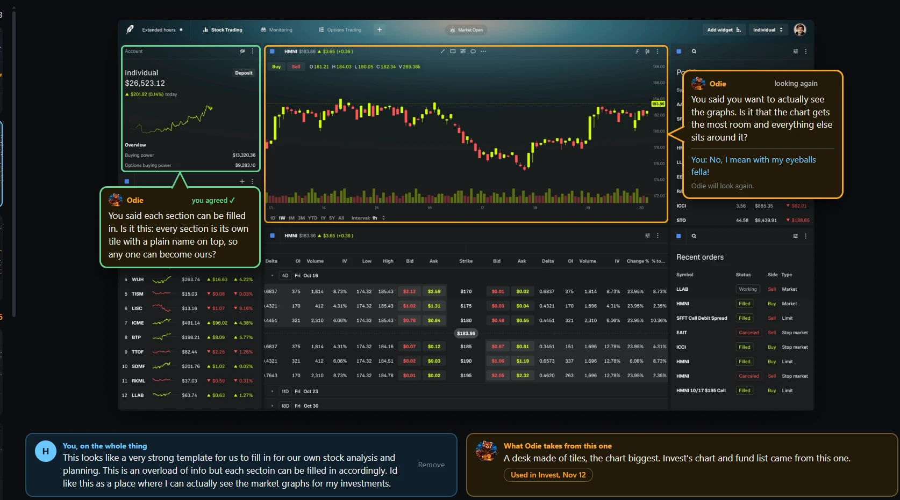
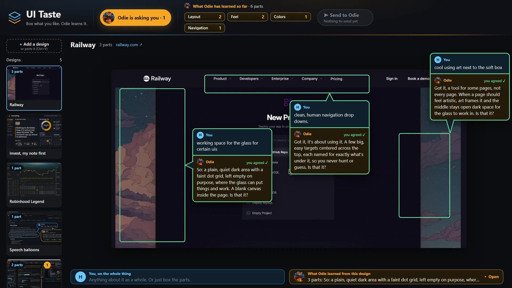

# UI Taste

A learning loop between you and your AI about what you like in a UI.

It's really hard to get an AI to know what you like when you're making UIs. And it's hard for a person to explain. Sometimes you just can't put it into words. So every build starts from the same generic look, and you fight your way up from there one small fix at a time.

UI Taste is what Odie and I built for that. It isn't just a folder where you save UIs you like. It's a direct connection to a learning loop with your AI:

1. **You drop in a design you like.** Paste a screenshot, drop a file on the page, or bring it from anywhere.
2. **You box the part you mean** and say a few words about it, as detailed as you want. Or no words, just the box.
3. **Your AI says back what it thinks you meant,** as a short question, right beside your box.
4. **You tap Yes, or Not quite** and steer it some more. It tries again until it gets it.
5. **When you say Yes, your AI has learned it.** The part gets sorted by what it is (layout, feel, colors, buttons, navigation, type), and you can see it in the top bar.

So it's not a shot in the dark. Your AI doesn't just have a pile of pictures. It has each part understood, with your own words about what you liked in it. And when it makes you something new, it starts from those parts, not from its own idea of "an app."

Built with Claude, and it works best with Claude.

## What it looks like

**Your AI can go first.** Here Odie boxed two parts of a trading screen I liked and guessed what I meant. I said Yes to the tiles on the left.

**When it's off the mark, you steer it.** Sort of. You can even mess with it a little and tell it you mean with your human eyeballs. It'll look again anyway.

**Three parts of one design, all agreed.** The navigation, the quiet working space, and the art beside it. Each one is in the top bar now, sorted by what it is. Click a kind and you see every part of that kind side by side.

The red panda is Odie. In your copy, your AI uses its own name and face (or its first letter until it has one).

## It all fits together

Each of my builds works on its own, and they all plug into each other the same way. Start with whichever one you want. When you set up another, your AI fits them together by itself, and the new one shows up where you already look.

- **[The glass](https://github.com/HunterBryson/the-glass):** a see-through layer over your screen. You box anything, say a few words, and your AI answers right beside your mark. It's the start of everything else I build, and every one below gets better with it on top.
- **[Homebase](https://github.com/HunterBryson/the-homebase):** my AI's memory as a web I can see. I box a line of it, say "this is old," and watch it get fixed. Everything else lands on its left side, one click away.
- **[The Den](https://github.com/HunterBryson/the-den):** a table my AI and I share. Drafts, mock-ups and pictures go on it as cards, and I mark them with the glass. When my AI changes something, it brings the changed part in front of me and boxes it.
- **[UI Taste](https://github.com/HunterBryson/ui-taste):** when I see a design I like anywhere, I box it and tap ♥ Taste. It goes in my folder, and my AI learns what I mean by "I like this."
- **[The shelves](https://github.com/HunterBryson/the-shelves):** a memory for your AI to move into. It's what Homebase draws, and the glass brings its own notes for it.

## Set it up

You need the Claude app on your own computer (Windows or Mac), with Claude Code (the Code tab) open in any folder. Paste this:

> Set up UI Taste for me from https://github.com/HunterBryson/ui-taste. Read its CLAUDE.md there first, then follow it. If anything asks for permission along the way, it's fine.

Your AI clones it, sets up its name and picture, opens the page, and shows you how it works on a design you like. There's nothing to install besides Node, and your AI checks that for you.

**Every day after:** say "open UI Taste" to your AI. When you've boxed some parts, press **➤ Send** on the page, then tell your AI "I sent you some in UI Taste." When you're about to make a UI together, say "check my UI Taste first."

If you use any of the builds above, your AI plugs UI Taste into them during setup.

## Where this stands, honestly

This is v2. It's what Odie and I use, and it's already made our UIs better: the first page we built from it took four small rounds instead of a long fight. New in v2: it's all one page now. You can box a part and say "Not this," and the screens you build with your AI go in too, the ones you love and the ones you don't. Your designs stay on your computer. Nothing leaves it until you press Send, and then it goes only to your own AI.

What I'm hoping for is that one day you can point at any site and your AI just knows what's good in it for you. Every Yes gets it a little closer.

**Something broke, or you have an idea?** Open an issue and pick a form; your AI can fill it in for you. Rather email? Write to hello@workbenchagents.com. Every issue and email reaches me, and I answer it myself, usually within a few days. Security problems go privately: see [SECURITY.md](https://github.com/HunterBryson/.github/blob/main/SECURITY.md). To update later, tell your AI "update UI Taste from GitHub."

Made by me, Hunter Bryson, and Odie. MIT licensed: your copy is yours to change.
